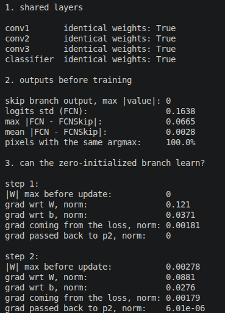
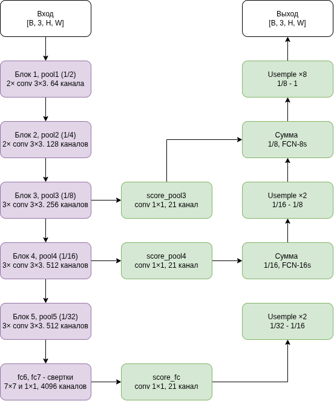

# Полностью свёрточные сети для семантической сегментации

**Материал:** J. Long, E. Shelhamer, T. Darrell. Fully Convolutional Networks for Semantic Segmentation. CVPR, 2015.

### Ответы на вопросы

1. В модели FCNSkip веса и смещения score_pool2 инициализированы нулями. Как это влияет на выход модели до обучения?
- Свертка 1×1 с нулевыми весами и смещениями выдает ноль при любом входе, поэтому $fused = up + 0$. Выход FCNSkip равен увеличенному предсказанию с глубокого уровня, и skip ничего не вносит. Это сделано намеренно, так же как в статье, новая ветвь не портит предсказание случайным шумом 

2. Сможет ли эта ветвь обучаться при такой инициализации? 
- Да. $\frac{dL}{dW} = \frac{dL}{dskip}*p2^T$  и не зависит от самих весов. Выход p2 ненулевой, а сложение передает ветви градиент без изменений.
На первом шаге W = 0, а $||\frac{dL}{dW}|| = 0.121$, поэтому после шага веса становятся ненулевыми. Единственный эффект нулевой инициализации,когда ветвь на первом шаге не передает градиент энкодеру, потому что $W^T*g = 0$. Со второго шага передает.

3. Будут ли предсказания FCN и FCNSkip до обучения совпадать?
- При одинаковом seed энкодер и классификатор совпадают, но выходы не идентичны. FCN увеличивает карту одной билинейной транспонированной свёрткой ×8, а FCNSkip двумя, ×2 и ×4, и их композиция даёт более гладкое ядро, чем одна билинейная интерполяция. Различие небольшое: максимум 0,067, в среднем 0,003 при разбросе логитов 0,16. Маски argmax на тестовом входе совпали на 100%, но это потому что необученная сеть почти везде предсказывает один класс. Без общего seed предсказания различались бы полностью

## 1. Пояснение статьи

**Задача.** Семантическая сегментация состоит в присвоении класса каждому пикселю изображения. Классификационные сети (AlexNet, VGG, GoogLeNet) определяют, что изображено, но из-за полносвязных слоёв выдают один вектор на всё изображение и не указывают, где находится объект. Предшествующие методы сегментации классифицировали отдельные фрагменты изображения и использовали дополнительную обработку (суперпиксели, гипотезы о регионах, условные случайные поля), что делало их медленными и не позволяло обучать их как единое целое.

**Предложение авторов.**

1. *Преобразование полносвязных слоёв в свёртки.* Полносвязный слой рассматривается как свёртка, ядро которой покрывает весь вход (в VGG16 слой fc6 заменяется свёрткой 7×7, слой fc7 свёрткой 1×1). Сеть становится полностью свёрточной, принимает изображение произвольного размера и выдаёт карту оценок классов вместо вектора.
2. *Перенос обучения.* Сеть VGG16, обученная на ImageNet, дообучается на задачу сегментации с попиксельной функцией потерь. Последний классификатор заменяется свёрткой 1×1 с 21 каналом (20 классов PASCAL VOC и фон).
3. *Увеличение разрешения внутри сети.* Карта оценок с шагом 32 увеличивается до размера входа транспонированной свёрткой, инициализированной билинейной интерполяцией.
4. *Пропускающие связи.* Предсказания глубоких слоёв семантически точны, но имеют низкое разрешение; неглубокие слои сохраняют детали. Их объединение даёт модели FCN-16s (добавлен слой pool4) и FCN-8s (добавлен слой pool3).

Модель FCN-8s достигла 62,2 mean IU на PASCAL VOC 2012, что соответствует относительному улучшению на 20% по сравнению с лучшим методом того времени, при времени обработки около 175 мс на изображение.

## 2. Роль основных операций

**Свёртка 1×1** является линейным классификатором, применяемым в каждой точке карты признаков. Она преобразует C каналов признаков в K каналов оценок классов, не изменяя пространственный размер, и эквивалентна полносвязному слою, применённому к каждому пикселю с общими весами.

**Уменьшение разрешения** выполняется пятью слоями max pooling с итоговым шагом 32. Оно расширяет рецептивное поле, позволяя учитывать контекст, и снижает объём вычислений, но приводит к потере мелких деталей и точности границ.

**Восстановление размера** выполняется транспонированной свёрткой: увеличение в f раз эквивалентно свёртке с дробным шагом 1/f. Её веса инициализируются билинейной интерполяцией; промежуточные слои увеличения затем обучаются вместе с сетью.

**Объединение признаков разных уровней** выполняется поэлементным сложением карт оценок классов, полученных свёртками 1×1 со слоёв pool4 и pool3, с увеличенным предсказанием глубокого слоя. Это сочетает семантику глубоких слоёв с пространственной точностью неглубоких и повышает mean IU с 59,4 (FCN-32s) до 62,4 (FCN-16s) и 62,7 (FCN-8s).

## 3. Результаты программной реализации

### 3.1. Описание моделей

Для проверки архитектурных решений реализованы две уменьшенные модели на PyTorch.

**Модель FCN** (файл `fcn.py`) содержит:

* свёрточный кодировщик из трёх блоков, каждый из которых состоит из свёртки 3×3, функции активации ReLU и max pooling с шагом 2; число каналов возрастает от 32 до 128, итоговый шаг равен 8;
* попиксельный классификатор в виде свёртки 1×1, преобразующей 128 каналов в 21;
* транспонированную свёртку с ядром 16 и шагом 8, инициализированную билинейной интерполяцией.

**Модель FCNSkip** (файл `fcn_skip.py`) дополняет предыдущую пропускающей связью по аналогии с FCN-16s. Карта оценок с шагом 8 увеличивается в 2 раза и суммируется с оценками, полученными свёрткой 1×1 по выходу второго блока с шагом 4. Затем результат увеличивается в 4 раза. Свёртка пропускающей ветви инициализирована нулями, как в статье.

Для обработки изображений произвольного размера вход дополняется нулями до размера, кратного 8, а выход обрезается до исходного размера. Без этого округление при пулинге приводит к несовпадению размеров: для высоты 375 итоговая карта имела бы высоту 368, а в модели FCNSkip складываемые карты имели бы разные размеры. В исходной реализации авторов эта задача решалась дополнением на 100 пикселей и последующей обрезкой.

### 3.2. Размеры промежуточных тензоров

Проверка выполнена для двух входов: одного изображения 256×256 и пакета из двух изображений 375×500. Второй размер выбран некратным шагу сети, что соответствует типичным изображениям PASCAL VOC.

**Таблица 1.** Размеры тензоров в модели FCN.

| Слой | Вход 1×3×256×256 | Вход 2×3×375×500 |
| --- | --- | --- |
| input | [1, 3, 256, 256] | [2, 3, 375, 500] |
| padded | [1, 3, 256, 256] | [2, 3, 376, 504] |
| block1 (1/2) | [1, 32, 128, 128] | [2, 32, 188, 252] |
| block2 (1/4) | [1, 64, 64, 64] | [2, 64, 94, 126] |
| block3 (1/8) | [1, 128, 32, 32] | [2, 128, 47, 63] |
| score (1/8) | [1, 21, 32, 32] | [2, 21, 47, 63] |
| upsample x8 | [1, 21, 256, 256] | [2, 21, 376, 504] |
| output (cropped) | [1, 21, 256, 256] | [2, 21, 375, 500] |
| mask (argmax) | [1, 256, 256] | [2, 375, 500] |

**Таблица 2.** Размеры тензоров в модели FCNSkip.

| Слой | Вход 1×3×256×256 | Вход 2×3×375×500 |
| --- | --- | --- |
| input | [1, 3, 256, 256] | [2, 3, 375, 500] |
| padded | [1, 3, 256, 256] | [2, 3, 376, 504] |
| block1 (1/2) | [1, 32, 128, 128] | [2, 32, 188, 252] |
| block2 (1/4) | [1, 64, 64, 64] | [2, 64, 94, 126] |
| block3 (1/8) | [1, 128, 32, 32] | [2, 128, 47, 63] |
| score (1/8) | [1, 21, 32, 32] | [2, 21, 47, 63] |
| upsample x2 | [1, 21, 64, 64] | [2, 21, 94, 126] |
| score_pool2 (1/4) | [1, 21, 64, 64] | [2, 21, 94, 126] |
| fuse (sum) | [1, 21, 64, 64] | [2, 21, 94, 126] |
| upsample x4 | [1, 21, 256, 256] | [2, 21, 376, 504] |
| output (cropped) | [1, 21, 256, 256] | [2, 21, 375, 500] |
| mask (argmax) | [1, 256, 256] | [2, 375, 500] |

### 3.3. Анализ результатов

Каждый блок кодировщика уменьшает пространственный размер вдвое и увеличивает число каналов, что соответствует принципу построения сетей семейства VGG. Свёртка 1×1 изменяет только число каналов (с 128 до 21) и сохраняет пространственный размер. Транспонированная свёртка возвращает карту к размеру дополненного входа, после чего обрезка восстанавливает исходный размер.

В модели FCNSkip увеличенная карта оценок и карта пропускающей ветви имеют одинаковый размер [2, 21, 94, 126], что делает возможным их поэлементное сложение. Это подтверждает корректность выбора параметров транспонированных свёрток: ядро 4 с шагом 2 и отступом 1 увеличивает размер ровно в 2 раза, ядро 8 с шагом 4 и отступом 2 увеличивает его ровно в 4 раза.

Для обоих размеров входа и обеих моделей выход имеет форму [batch, classes, height, width], а размеры height и width совпадают с размерами входного изображения. Тем самым подтверждено основное свойство полностью свёрточной сети: возможность обрабатывать изображения произвольного размера и получать плотное предсказание соответствующего размера.

